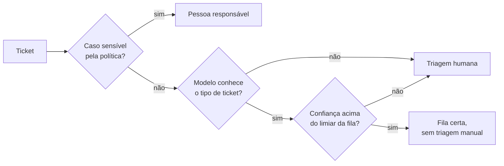

# Sumário executivo: triagem de suporte com IA

**Para:** conselho técnico · **De:** Diogo da Silva Carrico · **Data:** 13/10/2026

## Decisão pedida

Aprovar três passos, nesta ordem:

1. **Instrumentar a operação de suporte** para medir o que hoje não se mede: abertura do ticket, transferências, tempo de espera e reabertura.
2. **Um piloto de triagem automática em modo sombra**, com tickets da própria operação: a IA classifica em silêncio e nada muda para o cliente até ela provar 95% de precisão por fila.
3. **Manter com pessoas, por política,** tudo o que envolve dinheiro, contrato, segurança, dados pessoais ou risco físico.

## O que encontramos

- **Os dados entregues não sustentam um diagnóstico.** O conjunto de tickets é sintético, e o brief erra o volume (8.469 tickets, não 30 mil) e os tipos de ticket (5, não 3). Nenhum gargalo e nenhum fator de satisfação resistem a testes estatísticos.
- **O tempo de resposta não pode ser medido**, porque não há data de abertura dos tickets. Por isso a primeira recomendação é instrumentar.
- **A triagem é a menor parte do desperdício.** A estimativa, com premissas rotuladas, é de 100 horas por mês (R$ 4.502). O maior custo está em transferências e espera, que os dados não registram.

## O que propomos

A IA só encaminha o ticket. Ela não responde ao cliente, não concede acessos e não decide reembolsos. Cada correção feita por um agente vira dado de monitoramento.

## O que o protótipo mostra

| Indicador | Resultado | Leitura |
| --- | --- | --- |
| Acurácia do classificador | 86,7% | Medida em tickets de TI reais, num conjunto de teste usado uma só vez |
| Tickets roteados sozinhos | 64,9% | Com 97,0% de precisão; o resto vai para a triagem humana |
| Tickets de outra operação barrados | 98,1% | O modelo reconhece o que não conhece; por isso precisa ser retreinado com os tickets da nossa operação |
| Tamanho do piloto | 414 tickets roteados | Cerca de uma semana no volume do brief, para provar 95% de precisão no geral |

## Custos

| Opção | Custo mensal |
| --- | --- |
| Construir a triagem (roda localmente, sem API paga) | Cerca de R$ 40 de infraestrutura, mais horas de manutenção |
| Comprar IA para o helpdesk atual | De R$ 0 (quando já incluída no plano) a cerca de R$ 9.800 |

Antes de construir, vale verificar se o helpdesk atual já inclui IA de triagem.

## Riscos e como tratamos

| Risco | Como tratamos |
| --- | --- |
| O modelo aprendeu com tickets de TI de outra organização, em inglês | Retreinar com tickets da operação, em português, antes do piloto; até lá, o guarda manda para pessoas o que o modelo não conhece |
| Roteamento errado | Limiar por fila escolhido para 95% de precisão; correção com um clique; a fila volta ao modo assistido se a precisão cair |
| Caso sensível automatizado | Regras de política rodam antes do modelo e não podem ser ignoradas por ele |
| Dados de clientes enviados a terceiros | A triagem roda localmente; qualquer uso futuro de LLM só com plano pago e acordo de tratamento de dados |
| Benefício superestimado | Premissas rotuladas; o modo sombra mede os minutos reais de triagem |

## Próximos passos

| Quando | O quê |
| --- | --- |
| Semanas 1 e 2 | Instrumentar o helpdesk e separar tickets já classificados para o retreino |
| Semanas 3 e 4 | Retreinar com tickets da operação e rodar em modo sombra |
| Semanas 5 e 6 | Modo assistido nas filas que provarem 95% de precisão |
| Fim da semana 6 | Decisão, fila por fila, sobre o roteamento automático |

Detalhes: `docs/diagnostico.md`, `docs/proposta-automacao.md` e `docs/classificador.md`.
